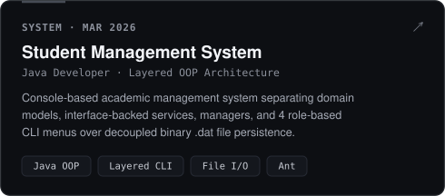

  

  <a href="#about">About</a> &nbsp;·&nbsp;
  <a href="#tech-stack">Tech Stack</a> &nbsp;·&nbsp;
  <a href="#featured-projects">Projects</a> &nbsp;·&nbsp;
  <a href="#roadmap">Roadmap</a> &nbsp;·&nbsp;
  <a href="#github-stats">Stats</a> &nbsp;·&nbsp;
  <a href="#connect">Connect</a>

---

## About

Software Engineering student at **FPT University (Can Tho)** focusing on **Java backend development**, **relational databases**, and **software architecture**.

- **Education:** B.Sc. in Software Engineering — **FPT University, Can Tho** <!-- UPDATE: Add years & GPA, e.g. `(2024 – 2028) · GPA: X.XX/4.0` -->
- **Currently building with:** Java (Jakarta EE 10), Apache Tomcat, Microsoft SQL Server (T-SQL), Maven, and Docker Compose.
- **Currently learning:** Spring Boot, REST API design, Linux/Nginx infrastructure, and CI/CD pipelines.
- **Research interests:** Applied AI engineering, analytical software systems, predictive modeling, and quantitative research.
<!-- UPDATE: Uncomment when actively applying for internships / roles
- **Status:** Open to Java Backend / Software Engineering Internship opportunities.
-->

<!-- UPDATE: Uncomment to add Internship / Work Experience
---

## Experience

**Role Title** — Company Name (`Month YYYY – Month YYYY`)
- Key backend, database, or infrastructure responsibility.
-->

---

## Tech Stack

 

 

 
 

 
 

<b>Used in projects:</b> Java (JDK 11–21), Jakarta EE 10, Tomcat, MS SQL Server, Maven, Ant, Docker, HTML/CSS/JS, Git &nbsp;|&nbsp; <b>Learning / Exploring:</b> Spring Boot, Python, PostgreSQL, Linux, Nginx, CI/CD, AI &amp; Quant

---

## Featured Projects

  
  &nbsp;
  

<b>CV Technical Breakdown (Click to expand)</b>

 

**1. [Ftech_learning_online](https://github.com/ngtaiphat1501/Ftech_learning_online)** — *Fullstack Developer (Team of 5) · Oct – Nov 2026*
- Built the **Admin Dashboard**, **Cart & Checkout pipeline**, and **Order History / Revenue Analytics** (Chart.js) on Java Web MVC (Jakarta EE 10 / Servlets / JSP) and Apache Tomcat 10.1.
- Implemented **idempotent order generation**, coupon validation, and VNPAY sandbox checkout flows to prevent duplicate transactions.
- Containerized the stack with a **multi-stage Dockerfile** (Maven + Temurin JDK 21 → Tomcat 10.1) and **Docker Compose** pairing Tomcat with Microsoft SQL Server 2022 (`healthcheck` + `LEARNORA_DB_URL` environment configuration).
- Integrated Excel import/export via Apache POI and aligned five team modules onto a shared SQL Server schema.

**2. [StudentManagementSystem](https://github.com/ngtaiphat1501/StudentManagementSystem)** — *Java Developer (Team Project) · Mar 2026*
- Designed a layered Java OOP structure (`models`, `services`/`*Impl`, `managers`, `menus`, `utils`) covering students, courses, enrollments, grades, activities, and training scores.
- Implemented four role-based console menus (`Admin`, `Staff`, `Teacher`, `Student`) isolated from binary `.dat` file persistence (`FileService`).

<!-- UPDATE: Add new project entries here as you publish them -->

<!-- UPDATE: Uncomment to add Certifications & Languages
---

## Certifications

- **Certification Name** — Issuer (`YYYY`)
- **Languages:** Vietnamese (Native), English (Working Proficiency)
-->

---

## Roadmap

  

---

## GitHub Stats

  
  &nbsp;
  
   
   
  
   
   
  

---

## Connect

  
  <!-- UPDATE: Uncomment and replace with your verified links when ready
  &nbsp;
  
  &nbsp;
  
  &nbsp;
  
  -->

