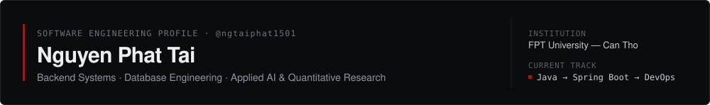
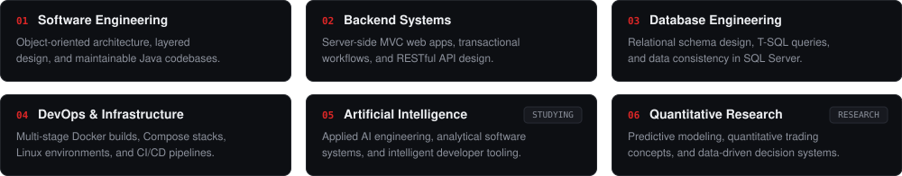
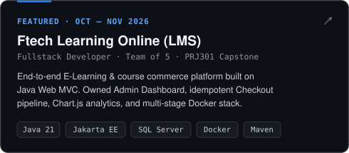
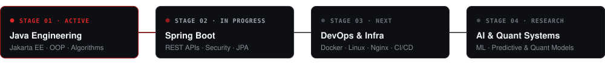

  

  <a href="#overview">Overview</a> &nbsp;·&nbsp;
  <a href="#engineering-focus">Focus</a> &nbsp;·&nbsp;
  <a href="#tech-stack">Stack</a> &nbsp;·&nbsp;
  <a href="#selected-projects">Projects</a> &nbsp;·&nbsp;
  <a href="#roadmap">Roadmap</a> &nbsp;·&nbsp;
  <a href="#github-activity">Activity</a> &nbsp;·&nbsp;
  <a href="#contact">Contact</a>

  

## Overview

Software Engineering student at **FPT University (Can Tho)** focusing on **Java backend development**, **relational database systems**, and **software architecture**.

Recent work centers on server-side web applications with Jakarta EE, Microsoft SQL Server, and Dockerized deployments. Currently advancing through Spring Boot, infrastructure engineering, and applied AI systems, with research interests in analytical software and quantitative modeling.

- **Education:** B.Sc. in Software Engineering — **FPT University, Can Tho** <!-- UPDATE: Add years & GPA, e.g. `(2024 – 2028) · GPA: X.XX/4.0` -->
- **Core Coursework:** Java OOP, Data Structures & Algorithms, Database Systems (SQL Server), Java Web Development, Software Engineering, Computer Networking, Operating Systems.
<!-- UPDATE: Uncomment when actively applying for internships / roles
- **Availability:** Open to Java Backend / Software Engineering Internship opportunities.
-->

<!-- UPDATE: Uncomment to add Internship / Work Experience
## Experience

**Role Title** — Company Name (`Month YYYY – Month YYYY`)
- Key backend, database, or infrastructure contribution.
-->

  

## Engineering Focus

  

  

## Tech Stack

 

 

 
 

 
 

<b>Used in projects:</b> Java (JDK 11–21), Jakarta EE 10, Tomcat, MS SQL Server (T-SQL), Maven, Ant, Docker, HTML/CSS/JS, Git &nbsp;|&nbsp; <b>Learning / Exploring:</b> Spring Boot, Python, PostgreSQL, Linux, Nginx, CI/CD, ML &amp; Quant

  

## Selected Projects

  
  &nbsp;
  

<b>CV Technical Breakdown (Click to expand)</b>

 

**1. [Ftech_learning_online](https://github.com/ngtaiphat1501/Ftech_learning_online)** — *Fullstack Developer (Team of 5) · Oct – Nov 2026*
- Built the **Admin Dashboard**, **Cart & Checkout pipeline**, and **Order History / Revenue Analytics** (Chart.js) on Java Web MVC (Jakarta EE 10 / Servlets / JSP) and Apache Tomcat 10.1.
- Implemented **idempotent order generation**, coupon validation, and VNPAY sandbox checkout flows to prevent duplicate transactions.
- Containerized the stack with a **multi-stage Dockerfile** (Maven + Temurin JDK 21 → Tomcat 10.1) and **Docker Compose** pairing Tomcat with Microsoft SQL Server 2022 (`healthcheck` + `LEARNORA_DB_URL` environment overrides).
- Integrated Excel import/export via Apache POI and synchronized five team modules onto a shared SQL Server schema.

**2. [StudentManagementSystem](https://github.com/ngtaiphat1501/StudentManagementSystem)** — *Java Developer (Team Project) · Mar 2026*
- Structured a layered Java OOP architecture (`models`, `services`/`*Impl`, `managers`, `menus`, `utils`) covering students, courses, enrollments, grades, activities, and training scores.
- Implemented four role-based console menus (`Admin`, `Staff`, `Teacher`, `Student`) isolated from binary `.dat` file persistence (`FileService`).

<!-- UPDATE: Add new project breakdown here when published -->

<!-- UPDATE: Uncomment to add Certifications & Languages

  

## Certifications

- **Certification Name** — Issuer (`YYYY`)
- **Languages:** Vietnamese (Native), English (Working Proficiency)
-->

  

## Roadmap

  

  

## GitHub Activity

  
  &nbsp;
  
   
   
  
   
   
  

  

## Contact

  
  <!-- UPDATE: Uncomment and replace with your verified links when ready
  &nbsp;
  
  &nbsp;
  
  &nbsp;
  
  -->

