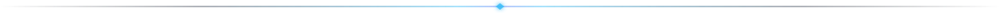

<div align="center">

<a href="https://github.com/ngtaiphat1501">
  
</a>

<br />
<br />

<a href="https://github.com/ngtaiphat1501">
  
</a>

<p align="center">
  
  
  
</p>

</div>

<p align="center">
  
</p>

### `01 // SYSTEM IDENTITY`

```yaml
architect:
  name: "Nguyen Phat Tai"
  handle: "@ngtaiphat1501"
  institution: "FPT University — Software Engineering"
  location: "Can Tho, Vietnam"

core_disciplines:
  - "Enterprise Backend Architecture (Java / Jakarta EE / MVC)"
  - "Relational Data Modeling & T-SQL Engineering (MS SQL Server)"
  - "Containerized Deployment & Reproducible Environments (Docker)"
  - "Applied AI Engineering, Data Structures & Algorithmic Systems"

design_ethos:
  aesthetic: "Minimalist, deliberate, distraction-free"
  engineering: "Modular architecture, predictable state, clean abstraction"
```

<p align="center">
  
</p>

### `02 // ARCHITECTURE STACK`

<div align="center">

<a href="https://skillicons.dev">
  
</a>

<br />
<br />


</div>

<p align="center">
  
</p>

### `03 // SELECTED SYSTEMS`

| System | Architectural Overview | Stack |
| :--- | :--- | :--- |
| **[Ftech_learning_online](https://github.com/ngtaiphat1501/Ftech_learning_online)** | End-to-end **E-Learning & Course Commerce Platform (LMS)** engineered on Java Web MVC with multi-role orchestration (Learner, Instructor, Admin), relational schema design, Dockerized runtime, and instant Dark/Light theming. | `Java` `Jakarta EE 10` `Tomcat` `T-SQL` `Maven` `Docker` |
| **[StudentManagementSystem](https://github.com/ngtaiphat1501/StudentManagementSystem)** | Modular **Object-Oriented Academic Management System** focused on clean domain modeling, encapsulated persistence, and deterministic record workflows. | `Java OOP` `Ant` `File I/O` |

<p align="right">
  <sub><code>+ 25 private repositories spanning algorithmic engineering, academic systems &amp; experimental builds.</code></sub>
</p>

<p align="center">
  
</p>

### `04 // LIVE TELEMETRY`

<div align="center">
  <a href="https://github.com/ngtaiphat1501">
    
  </a>
  &nbsp;
  <a href="https://github.com/ngtaiphat1501">
    
  </a>
  <br />
  <br />
  <a href="https://github.com/ngtaiphat1501">
    
  </a>
</div>

<p align="center">
  
</p>

### `05 // CONTRIBUTION MATRIX`

<div align="center">
  <picture>
    <source media="(prefers-color-scheme: dark)" srcset="https://raw.githubusercontent.com/ngtaiphat1501/ngtaiphat1501/output/github-contribution-grid-snake-dark.svg" />
    <source media="(prefers-color-scheme: light)" srcset="https://raw.githubusercontent.com/ngtaiphat1501/ngtaiphat1501/output/github-contribution-grid-snake.svg" />
    
  </picture>
</div>

<p align="center">
  
</p>

### `06 // SIGNAL`

<div align="center">
  <a href="https://github.com/ngtaiphat1501">
    
  </a>
  &nbsp;
  <a href="mailto:ngtaiphat1501@gmail.com">
    
  </a>
  &nbsp;
  <a href="https://www.linkedin.com/">
    
  </a>
  <br />
  <br />
  <sub><code>// PRECISION OVER NOISE &mdash; @ngtaiphat1501</code></sub>
</div>
